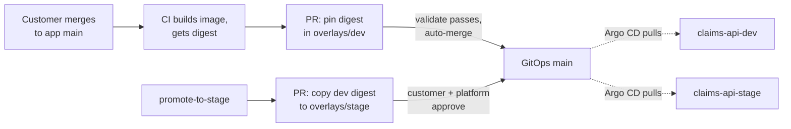

# claims-api onboarding

Forward deployed engineer assessment: onboard the customer's `claims-api` to the shared
Hosting Services platform, with dev now and stage next, without creating a snowflake.

## Goal and scope

The customer asked for a URL for the API, automatic deploys, a password kept out of Git,
guidance for when it is unhealthy, and no per-environment copies of manifests. This
submission delivers:

- one Kustomize base with thin dev and stage overlays, drift-checked;
- a pull-request-based delivery path where CI never holds cluster credentials;
- validation that runs the same way on a laptop and in CI;
- alert rules, a smoke test, a runbook, and a customer handoff.

**Out of scope:** changing the application or its image; creating the database, Secret
value, cluster, or ingress controllers (platform-owned); production; a real deployment.
All validation here is static or against local stand-ins, and says so.

## How to read this

Start with `docs/engagement.md` (what was known, assumed, and asked), then this README,
`runbook.md`, and `ai-usage.md`.

| Brief task | Where |
| --- | --- |
| 1. Shape the engagement | `docs/engagement.md`: facts, assumptions (A1–A16), open questions (Q1–Q11), defaults, acceptance criteria |
| 2. Reusable integration | `solution/k8s/` base and overlays |
| 3. Delivery path | `.github/workflows/`, `solution/ci/`, `solution/argocd/`, `docs/delivery.md` (trust boundary and permissions) |
| 4. Supportability | `tests/smoke.py`, `solution/observability/`, `docs/observability.md`, `runbook.md`, `docs/handoff.md` |
| 5. Next increment | `docs/next-increment.md` |

| Submission contract | Here |
| --- | --- |
| `README.md` | This file |
| `solution/` | `solution/k8s/` (manifests), `solution/ci/` (release workflow, digest tool, CODEOWNERS), `solution/argocd/` (Applications), `solution/observability/` (alerts). The GitOps repository's own workflows are in `.github/`, where GitHub runs them. |
| `tests/` | `tests/validate.py` and the checks and unit tests it runs (`tests/README.md`) |
| `evidence/` | Rendered manifests and validation runs, each labelled with where it ran (`evidence/README.md`) |
| `runbook.md` | Operations and support handoff |
| `ai-usage.md` | AI assistance and what was verified |
| (extra) `docs/` | Engagement, delivery, observability, customer handoff, next increment |
| (extra) `inputs/` | The original brief, starter pack and submission contract, unchanged |

## Architecture



Each environment runs in its own namespace:

- 2 replicas, rolling updates that never drop a ready pod (`maxUnavailable: 0`), a
  PodDisruptionBudget.
- Liveness on `/healthz` (process only) and readiness on `/readyz` (database), so a
  database outage stops traffic without restarting pods.
- Non-root, read-only root filesystem, no Kubernetes API token, all capabilities dropped.
- `DATABASE_URL` referenced from a platform-delivered Secret; nothing secret in Git.
- Ingress with an explicit hostname, HTTPS only, on an **internal** load balancer until
  authentication and rate limiting are confirmed (Q1, Q2).
- Default-deny network policy; egress only to DNS and the database address.

Details and reasoning are in comments in each manifest and in `docs/`.

## Key assumptions

The full list, with what changes if each is wrong, is in `docs/engagement.md`. The ones
that shape the design most:

- **A4:** callers' authentication and rate limiting are unconfirmed, so the load balancer
  stays internal; going public is one reviewed overlay change.
- **A5:** the platform's ingress is the AWS Load Balancer Controller (class `alb`); only its
  standard annotations are used.
- **A2, A3:** the platform creates Secret `claims-api-db` and supplies the database
  address; placeholders are used until then (`192.0.2.x` documentation addresses).
- **A9:** dev may auto-merge the bot's one-line pull requests; stage needs human approval.
- **A12:** no real image exists, so overlays pin a reproducible synthetic digest.
- **A10:** Kubernetes 1.30 or newer.

## Validation

From a clean checkout, at the repository root. Needs Python 3.9+, PyYAML, kustomize v5.4+
and kubeconform; `promtool` is optional locally and required in CI. Install steps for
Windows, macOS and Linux are in `tests/README.md`.

```sh
python -m pip install -r tests/requirements.txt
python tests/validate.py            # add --strict to require promtool, as CI does
```

What it does, in 7 steps: render both overlays; validate against Kubernetes 1.30 schemas;
run 10 contract checks per environment; fail on any dev/stage difference outside the
approved fields; scan the repository for credentials; run 42 unit tests (manifests,
delivery path and workflow trust rules, smoke test against local stand-ins); check and
unit-test the alert rules. It prints `RESULT: PASS` or names every failure, exits
non-zero on failure, and writes `evidence/validation-<where>.txt`.

Other commands:

```sh
python tests/smoke.py https://claims-api.dev.apps.example.invalid   # against a real deployment (not run: none exists)
actionlint .github/workflows/*.yml solution/ci/app-repo-release.yml  # workflow lint, run in CI
```

**Evidence** (`evidence/`): runs in a Linux container used during AI-assisted development
(with `promtool` and `actionlint`), and on the candidate's Windows laptop (without
`promtool`, so the alert step shows SKIP). Each file records the commit, a content
fingerprint over `solution/`, `tests/` and `.github/`, and tool versions. Matching
fingerprints show both machines checked identical files.

**Not validated**, because it needs real infrastructure: an image push, GitHub Apps and
environments, auto-merge, Argo CD syncing, the load balancer and certificate, pods
starting, and database connectivity. `runbook.md` section 3 is the procedure for
verifying those after a real deployment.

## Trade-offs and next steps

| Decision | Trade-off | For production |
| --- | --- | --- |
| Internal load balancer | The customer cannot reach it from the internet yet | Go public after Q1, Q2 and Q9 (block `/metrics`); add WAF/rate limiting if the platform offers it |
| Placeholders for Secret name, database address, repository and team names | Needs a short confirmation pass | Replace from Q3, Q4, Q7 answers |
| Kubernetes-level alerts only | No error-rate or latency alerts yet | Add application alerts once metric names are known (Q11) |
| Fixed 2 replicas, conservative resources | No autoscaling | Tune from real metrics; consider autoscaling |
| Registry push credential as an environment secret | A stored credential | Short-lived OIDC push role if the registry supports it (Q10) |
| Checks live in this repository | Each service would copy them | Move shared checks into platform policy (`docs/next-increment.md`) |
| Proposed Argo CD Applications and CODEOWNERS | Platform team owns the real ones | Platform applies its equivalent |

What to standardize after this onboarding, and the evidence that should trigger it, is in
`docs/next-increment.md`.
