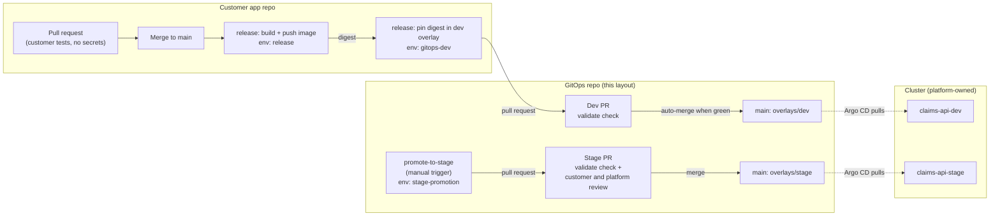

# Delivery path and trust boundary

How a change to `claims-api` reaches dev and then stage, who can do each step, and which
credentials exist where. Task 3 of the brief.

**In short**

- Nobody hand-edits image references. CI pins the immutable digest the registry returned
  and proposes it as a pull request to the GitOps repository.
- Argo CD **pulls** approved changes from Git. CI never holds cluster credentials, so no
  workflow, trusted or not, can change the cluster directly.
- Untrusted code (every pull request, including forks) runs with a read-only token and no
  secrets. Credentials exist only in jobs that run after a reviewed merge, inside a
  protected GitHub environment.

## 1. Flow

| # | Step | Trigger | Runs where | Credential used |
| --- | --- | --- | --- | --- |
| 1 | Customer tests on a pull request | PR in app repo | App repo CI | None (read-only token) |
| 2 | Build and push the image | Merge to app `main` | `release` job, environment `release` | Registry push credential (A13) |
| 3 | Pin the new digest in `overlays/dev` and open a PR | After step 2 | `deploy-dev` job, environment `gitops-dev` | GitHub App token, scoped to the GitOps repo, 1 hour |
| 4 | Validate the PR | PR in GitOps repo | `validate` workflow | None (read-only token) |
| 5 | Merge to dev | `validate` passes | GitHub auto-merge (A9) | None |
| 6 | Apply to the dev namespace | Commit on `main` | Argo CD, inside the cluster | Argo CD's own repo read access |
| 7 | Propose stage promotion | Someone runs `promote-to-stage` | Environment `stage-promotion` | GitHub App token, this repo only |
| 8 | Approve and merge to stage | Customer + platform review, `validate` green | GitHub | None |
| 9 | Apply to the stage namespace | Commit on `main` | Argo CD | Argo CD's own repo read access |

Files:

| File | Where it lives in real use |
| --- | --- |
| `.github/workflows/validate.yml` | GitOps repo; required check on `main` |
| `.github/workflows/promote-to-stage.yml` | GitOps repo |
| `.github/actions/setup-tools/action.yml` | GitOps repo; pinned, checksum-verified tool installs |
| `solution/ci/app-repo-release.yml` | Customer app repo as `.github/workflows/release.yml` |
| `solution/ci/set_image_digest.py` | GitOps repo; changes exactly one line in an overlay |
| `solution/ci/CODEOWNERS` | GitOps repo as `.github/CODEOWNERS` (proposed) |
| `solution/argocd/claims-api-{dev,stage}.yaml` | Applied by the platform team (proposed) |

## 2. Trust boundary

| Zone | What runs there | What it can reach |
| --- | --- | --- |
| Untrusted | Any pull request, including forks, in either repository | Read-only repository token. No secrets, no environments, no cluster. |
| Trusted, after merge | `release` and `promote-to-stage` jobs on `main` | Only the secret of their own environment: a registry push credential, or a GitHub App key that can open pull requests. |
| Cluster | Argo CD | Reads Git. It is the only thing that changes the namespaces, and only to match an approved commit. |

Rules, each enforced by a test in `tests/test_delivery.py` where it can be checked
statically:

1. **No cluster credentials in CI at all.** Deployment is a Git merge that Argo CD pulls.
   There is no kubeconfig or cloud deploy role to leak.
2. **Pull requests never see secrets.** The PR workflow references no secrets. Jobs that do
   use secrets are not triggered by pull requests and must run in a GitHub environment.
   (tested)
3. **No `pull_request_target` or `workflow_run`.** Those run with repository privileges
   on events that untrusted code can cause. (tested)
4. **Read-only default token.** Every workflow sets `permissions: contents: read`, and no job
   widens it. Pull requests are opened with a GitHub App token instead. (tested)
5. **Short-lived, narrowly scoped tokens.** The GitHub App token lasts one hour and is
   limited to one repository. No personal access tokens.
6. **Pinned supply chain.** Third-party actions are pinned to full commit SHAs (the version
   is kept as a comment). Tool downloads are checked against the published sha256 before
   use. (tested)
7. **No credentials left on disk.** `actions/checkout` runs with
   `persist-credentials: false`. (tested)
8. **No script injection.** Values from earlier steps reach shell commands through `env`,
   not by pasting `${{ }}` into the script.

Why a GitHub App token to open pull requests: pull requests created with the default
`GITHUB_TOKEN` do not trigger other workflows, so the required `validate` check would never
run and the PR could never merge. The App token fixes that without a personal access token.

## 3. Permissions needed

| Identity | Permission | Scope | Where the key lives |
| --- | --- | --- | --- |
| `GITHUB_TOKEN` (all workflows) | `contents: read` | The repository running the workflow | Issued by GitHub per job |
| GitOps deploy App (used by the app repo) | Contents: write, Pull requests: write | GitOps repository only | App repo environment `gitops-dev` |
| Promotion App (used by the GitOps repo) | Contents: write, Pull requests: write | GitOps repository only | GitOps repo environment `stage-promotion` |
| Registry push credential | Push to `registry.example.invalid/claims-api` only | That image repository | App repo environment `release` (A13) |
| Argo CD | Read the GitOps repository | GitOps repository | Platform-managed |

The two Apps may be one App installed once; they are listed separately to show each use.
Neither App can approve pull requests or bypass required checks.

## 4. Repository settings the platform team applies

Written down because they are part of the design, but they are GitHub settings, not files:

- **Ruleset on `main` (GitOps repo):** pull request required; `validate` must pass; no
  force pushes or deletions.
- **Stage approvals:** a ruleset for `solution/k8s/overlays/stage/**` requiring approval
  from both `claims-team` and `platform-team`. A CODEOWNERS line with two teams means
  *either* team can approve, so CODEOWNERS alone is not enough.
- **Dev auto-merge (A9):** auto-merge enabled; for `solution/k8s/overlays/dev/**` the
  deploy App's pull requests need only the `validate` check. Anything outside the digest
  line (enforced by `set_image_digest.py` changing one line, and by the drift check)
  still needs human review.
- **Environments:** `stage-promotion` and `gitops-dev` limited to the `main` branch, with
  required reviewers on `stage-promotion` if the customer wants a person to start every
  promotion.
- **Base changes:** `solution/k8s/base/**` changes affect both environments, so they
  require platform review.

## 5. Promotion and drift

- Stage only ever receives a digest that is already in dev: the promotion workflow copies
  it rather than accepting free input. What was tested in dev is byte-for-byte what runs in
  stage.
- The promotion PR changes one line. The `validate` check fails if dev and stage differ in
  anything other than the approved overlay fields (`docs/engagement.md`, section 5).
- Configuration changes (for example `LOG_LEVEL`) go through the same PR review as image
  changes, and roll out through the same zero-downtime rolling update because the
  ConfigMap name changes with its content.

## 6. Rollback

Rollback is a Git revert of the deploy or promotion commit, reviewed and merged like any
other change; Argo CD then applies the previous digest with the same rolling update.
The step-by-step procedure, including the faster emergency path, is in `runbook.md`.

## 7. Assumptions and integration points

| Ref | Assumption | Default in this design |
| --- | --- | --- |
| A9 | Dev may auto-merge bot PRs once checks pass | Auto-merge on the dev path only |
| A13 | The customer registry accepts a push credential stored as a GitHub environment secret | `REGISTRY_PUSH_TOKEN` in environment `release`. If the registry supports OIDC federation from GitHub Actions (Q10), replace it with a short-lived push role and delete the secret. |
| A14 | The GitOps repository uses this repository's layout, at `example-org/platform-gitops` | Paths and repository name are placeholders until Q7 is answered |
| — | Argo CD Applications and the AppProject are owned by the platform team | Proposed manifests in `solution/argocd/`; `project: claims` assumed to exist |

## 8. What was validated

| Check | Where it ran | Result |
| --- | --- | --- |
| `actionlint` on all three workflows (syntax, expressions, action inputs) | Linux container and GitHub Actions (`validate` job) | See `evidence/` |
| `tests/test_delivery.py`: digest pinning, Argo CD wiring, trust rules | Same as `tests/validate.py` | See `evidence/` |
| Action SHAs | Resolved from the tags with `git ls-remote` when written | Versions in comments |
| Tool checksums | Matched against each release's published checksum file | In `setup-tools/action.yml` |

**Not** validated, because it needs real infrastructure: the release workflow pushing an
image, GitHub Apps and environments, auto-merge behaviour, and Argo CD syncing. The
`validate` workflow itself runs for real once this repository is pushed to GitHub.
